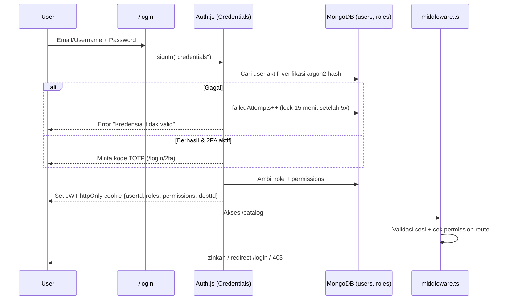

# ENERCO VAULT — Technical Architecture & Development Blueprint (v2.1 — IMS + RBAC Edition)

**Project Name:** Enerco Vault (Enterprise Document Management & Integrated Compliance System)
**Tech Stack:** Next.js 15 (App Router, TypeScript), MongoDB 7 (Mongoose), Auth.js v5 (NextAuth), Custom On-Premise Storage Engine, Tailwind CSS, Shadcn UI, `pdf-lib`, `react-pdf`
**Compliance Scope:** Legalitas Perusahaan Indonesia, SMK3 (PP No. 50/2012), ISO 9001:2015 (QMS), ISO 14001:2015 (EMS), ISO 45001:2018 (OHSMS)

---

## 1. Executive Summary & Core Philosophy

**Enerco Vault** adalah *Single Source of Truth* untuk pengendalian dokumen korporasi dan operasional proyek, dengan arsitektur **Integrated Management System (IMS / QHSE)**, **100% Dynamic Taxonomy**, dan **Role-Based Access Control (RBAC)** yang ketat.

1. **Zero Cloud-Storage Dependency** — Seluruh file disimpan on-premise via *Custom File Storage Engine* (Node.js Streams, SHA-256, AES-256). Tanpa AWS S3 / Cloudflare R2.
2. **100% Dynamic Taxonomy & Custom Metadata** — Kategori, sub-kategori, dan field form dikelola dari UI (tidak di-*hardcode*).
3. **Annex SL / HLS Cross-Mapping** — Satu dokumen dapat dipetakan sekaligus ke ISO 9001, 14001, 45001 (Klausul 4–10) dan elemen SMK3.
4. **Secure-by-Default RBAC** — Setiap halaman, Server Action, dan API route wajib melewati autentikasi + pengecekan *permission*. **Super Admin** memiliki **seluruh privilege di semua fitur** (wildcard `*:*`), dengan semua aksinya tetap tercatat di Audit Log.

---

## 2. Arsitektur Sistem & Tech Stack

| Layer | Teknologi | Fungsi Utama |
| :--- | :--- | :--- |
| **Fullstack** | Next.js 15 (App Router, TS) | SSR, Server Actions, Route Handlers untuk *binary streaming*. |
| **Auth & Session** | Auth.js v5 (Credentials Provider), `argon2`, `otplib` | Login email/username + password, sesi JWT (httpOnly cookie), 2FA TOTP opsional/wajib untuk Super Admin. |
| **Authorization** | `middleware.ts` + `lib/rbac.ts` | Proteksi route, guard Server Action/API, filter query berdasarkan `accessLevel` & departemen. |
| **Database** | MongoDB 7.0+ (Mongoose) | Skema dinamis, *Wildcard Index* atribut kustom, *Aggregation Pipeline* matriks IMS. |
| **Storage Engine** | `fs/promises`, `stream`, `crypto` | Direktori lokal terisolasi, *chunked upload*, SHA-256, ZIP *on-the-fly*. |
| **PDF Processing** | `pdf-lib`, `qrcode` | QR validasi, stamp revisi, watermark dinamis saat unduh/cetak. |
| **UI / UX** | Tailwind CSS, Shadcn UI, Lucide | Dark/Light Mode, Command Palette (`Ctrl+K`), Split-Screen Viewer. |

---

## 3. Authentication & Role-Based Access Control (RBAC)

### 3.1. Alur Login



**Kebijakan Keamanan Login:**
- Password di-hash dengan **argon2id**; minimal 10 karakter, kombinasi huruf/angka/simbol.
- **Account lockout**: 5x gagal → terkunci 15 menit (Super Admin dapat membuka kunci).
- **2FA TOTP wajib** untuk role `SUPER_ADMIN` dan `PRESIDENT_DIRECTOR`; opsional untuk role lain.
- Sesi JWT berlaku 8 jam (*idle timeout* 30 menit), cookie `httpOnly`, `secure`, `sameSite=lax`.
- Fitur **Force Logout / Revoke Session** (via `sessionVersion` di dokumen user).
- Tidak ada registrasi publik — akun dibuat oleh Super Admin / Corporate Secretary.
- Opsional Fase lanjut: integrasi **LDAP / Active Directory** perusahaan.

### 3.2. Model Permission

Format permission: **`resource:action`**. Super Admin memegang wildcard **`*:*`**.

| Resource | Actions |
| :--- | :--- |
| `dashboard` | `view` |
| `ims_matrix` | `view`, `export` |
| `document` | `view`, `view_confidential`, `create`, `update`, `delete`, `download`, `download_original`, `print`, `view_archive` |
| `bundle` | `view`, `create`, `update`, `delete`, `export_zip` |
| `dcr` | `view`, `create`, `review_technical`, `review_doccontrol`, `approve_final`, `override`, `cancel` |
| `taxonomy` | `view`, `manage` |
| `framework` | `view`, `manage` |
| `user` | `view`, `create`, `update`, `delete`, `reset_password`, `unlock`, `impersonate` |
| `role` | `view`, `manage` |
| `department` | `view`, `manage` |
| `audit_log` | `view`, `export` |
| `system` | `settings`, `backup`, `restore`, `storage_maintenance` |

### 3.3. Daftar Role Default (Seed)

| Role | Deskripsi | Ringkasan Akses |
| :--- | :--- | :--- |
| **SUPER_ADMIN** | Pemilik sistem / IT Admin | **`*:*` — SEMUA privilege di SEMUA fitur** (lihat 3.5) |
| **CORPORATE_SECRETARY** | Document Controller | Kelola dokumen, taxonomy, bundle, review DCR tata naskah, kelola user non-admin |
| **QHSE_MANAGER** | Koordinator IMS/QHSE | Review teknis DCR, kelola framework & klausul, lihat matriks IMS |
| **DEPT_MANAGER** | Manajer Unit/Departemen | Review teknis DCR departemennya, lihat dokumen RESTRICTED departemennya |
| **PRESIDENT_DIRECTOR** | Manajemen Puncak | Final approval DCR, lihat semua dokumen termasuk CONFIDENTIAL |
| **AUDITOR** | Auditor internal/eksternal (read-only) | Lihat dokumen, arsip versi lama, matriks IMS, audit log; ekspor bundle audit |
| **CONTRIBUTOR** | Staf penyusun dokumen | Ajukan DCR, lihat dokumen INTERNAL, unduh salinan terkendali |
| **VIEWER** | Pekerja lapangan / umum | Lihat & unduh dokumen PUBLIC/INTERNAL (ber-watermark) |

### 3.4. Matriks Akses per Fitur

✅ = penuh · 🔸 = terbatas (scope departemen / level akses) · 👁 = read-only · ❌ = tidak ada

| Fitur | SUPER_ADMIN | CORP_SEC | QHSE_MGR | DEPT_MGR | PRES_DIR | AUDITOR | CONTRIBUTOR | VIEWER |
| :--- | :---: | :---: | :---: | :---: | :---: | :---: | :---: | :---: |
| 1. Dasbor & Matriks IMS | ✅ | ✅ | ✅ | 🔸 | ✅ | 👁 | 🔸 | ❌ |
| 2. Katalog & Bundle | ✅ | ✅ | 🔸 | 🔸 | 👁 | 👁 | 👁 | 👁 |
| 3. Pencarian & Filter | ✅ | ✅ | ✅ | 🔸 | ✅ | ✅ | 🔸 | 🔸 |
| 4. Viewer (CONFIDENTIAL) | ✅ | ✅ | 🔸 | ❌ | ✅ | 🔸 | ❌ | ❌ |
| 4. Arsip Versi Lama | ✅ | ✅ | ✅ | 🔸 | ✅ | 👁 | ❌ | ❌ |
| 4. Unduh File Asli (tanpa watermark) | ✅ | 🔸 | ❌ | ❌ | ❌ | ❌ | ❌ | ❌ |
| 5. DCR — Ajukan | ✅ | ✅ | ✅ | ✅ | ✅ | ❌ | ✅ | ❌ |
| 5. DCR — Review/Approve | ✅ (semua step) | Step 2 | Step 1 | Step 1 | Step 3 | ❌ | ❌ | ❌ |
| 5. DCR — Override/Force Approve | ✅ | ❌ | ❌ | ❌ | ❌ | ❌ | ❌ | ❌ |
| Settings: Taxonomy & Form Builder | ✅ | ✅ | 👁 | ❌ | ❌ | ❌ | ❌ | ❌ |
| Settings: Framework & Klausul | ✅ | 👁 | ✅ | ❌ | ❌ | 👁 | ❌ | ❌ |
| Settings: User & Departemen | ✅ | 🔸 (non-admin) | ❌ | ❌ | ❌ | ❌ | ❌ | ❌ |
| Settings: Role & Permission | ✅ | ❌ | ❌ | ❌ | ❌ | ❌ | ❌ | ❌ |
| Audit Log | ✅ | 👁 | ❌ | ❌ | 👁 | 👁 | ❌ | ❌ |
| System: Backup/Restore/Storage | ✅ | ❌ | ❌ | ❌ | ❌ | ❌ | ❌ | ❌ |

### 3.5. Super Admin — All Privileges

Super Admin memiliki **akses penuh tanpa batasan** ke seluruh fitur:

- **Bypass semua pengecekan permission** — `can(user, any)` selalu `true` jika role memuat `*:*`.
- **Bypass scope data** — melihat semua departemen dan semua `accessLevel` (PUBLIC → CONFIDENTIAL), termasuk dokumen DRAFT, OBSOLETE, dan EXPIRED.
- **Dokumen** — create / update / delete (soft & hard delete), restore dari arsip, unduh file asli tanpa watermark.
- **DCR** — dapat bertindak di **step mana pun**, **force approve / skip step / reject / reassign approver** (wajib isi alasan override).
- **Master Data** — kelola Taxonomy, Custom Field, Framework & Klausul, Departemen, Bundle.
- **User & Role** — buat/edit/hapus user (termasuk admin lain), reset password, unlock akun, revoke sesi, **impersonate user** (untuk troubleshooting, ditandai banner merah), buat role kustom & atur permission.
- **System** — konfigurasi aplikasi, backup/restore (`mongodump` + `rsync`), maintenance storage (verifikasi checksum, cleanup `temp_uploads`).
- **Audit Log** — lihat & ekspor seluruh log.

**Guardrails (tetap berlaku untuk Super Admin):**
- Semua aksi Super Admin **wajib tercatat** di `audit_logs` (tidak dapat dihapus, *append-only*).
- 2FA TOTP wajib.
- Minimal **1 Super Admin aktif** harus selalu ada (sistem menolak penghapusan/penurunan role Super Admin terakhir).
- Aksi destruktif (hard delete, restore DB, override DCR) memerlukan konfirmasi ulang password.

### 3.6. Skema Koleksi Auth

```javascript
// users
{
  _id: ObjectId("..."),
  username: "superadmin",
  email: "admin@enerco.co.id",
  fullName: "System Administrator",
  passwordHash: "$argon2id$v=19$...",
  roleIds: [ObjectId("role_super_admin")],
  departmentId: ObjectId("..."),
  isActive: true,
  twoFactor: { enabled: true, secretEnc: "..." },
  security: { failedAttempts: 0, lockedUntil: null, sessionVersion: 1, lastLoginAt: ISODate("...") },
  createdAt: ISODate("..."), updatedAt: ISODate("...")
}

// roles
{
  _id: ObjectId("role_super_admin"),
  code: "SUPER_ADMIN",
  name: "Super Administrator",
  isSystem: true,              // Role sistem tidak dapat dihapus
  permissions: ["*:*"],        // Wildcard = semua privilege
  dataScope: "ALL"             // ALL | DEPARTMENT | OWN
}
{
  code: "CORPORATE_SECRETARY",
  permissions: ["dashboard:view", "document:*", "bundle:*", "dcr:view", "dcr:create",
                "dcr:review_doccontrol", "taxonomy:manage", "user:view", "user:create",
                "user:update", "audit_log:view"],
  dataScope: "ALL"
}

// audit_logs (append-only)
{
  _id: ObjectId("..."),
  actorId: ObjectId("..."), actorRole: "SUPER_ADMIN",
  impersonatedBy: null,
  action: "dcr.override_approve",   // login.success, login.failed, document.download, user.update, ...
  resource: { type: "dcr", id: ObjectId("...") },
  reason: "Urgent revisi prosedur tanggap darurat",
  ip: "10.0.0.12", userAgent: "...",
  at: ISODate("...")
}
```

### 3.7. Implementasi Guard

```typescript
// src/lib/rbac.ts
export function can(user: SessionUser, perm: `${string}:${string}`): boolean {
  if (user.permissions.includes("*:*")) return true;            // Super Admin
  const [res] = perm.split(":");
  return user.permissions.includes(perm) || user.permissions.includes(`${res}:*`);
}

export async function requirePermission(perm: `${string}:${string}`) {
  const session = await auth();
  if (!session?.user) redirect("/login");
  if (!can(session.user, perm)) throw new ForbiddenError(perm);
  return session.user;
}

// Filter query dokumen berdasarkan scope
export function documentScopeFilter(user: SessionUser) {
  if (user.permissions.includes("*:*") || user.dataScope === "ALL") return {};
  const levels = can(user, "document:view_confidential")
    ? ["PUBLIC", "INTERNAL", "RESTRICTED", "CONFIDENTIAL"]
    : ["PUBLIC", "INTERNAL"];
  return { $or: [{ accessLevel: { $in: levels } }, { departmentId: user.departmentId }] };
}
```

```typescript
// src/middleware.ts — peta route → permission
const ROUTE_PERMISSIONS: Record<string, string> = {
  "/":                     "dashboard:view",
  "/catalog":              "document:view",
  "/ims-matrix":           "ims_matrix:view",
  "/dcr":                  "dcr:view",
  "/dcr/new":              "dcr:create",
  "/settings/taxonomies":  "taxonomy:manage",
  "/settings/frameworks":  "framework:manage",
  "/settings/users":       "user:view",
  "/settings/roles":       "role:manage",
  "/audit-logs":           "audit_log:view",
  "/system":               "system:settings",
};
// Public: /login, /login/2fa, /verify/[token]
```

> **Prinsip:** Middleware hanya lapisan pertama. **Setiap Server Action & Route Handler wajib memanggil `requirePermission()`** dan setiap query dokumen wajib memakai `documentScopeFilter()`.

---

## 4. Desain Custom Local File Storage Engine

Lokasi fisik dipisahkan dari struktur kategori logis (*Decoupled Physical Storage*), sehingga rename/pindah kategori tidak memindahkan file.

### 4.1. Struktur Direktori Server (`/var/enerco-vault/`)

```text
/var/enerco-vault/
├── storage/
│   ├── active/                  # Dokumen ACTIVE / APPROVED
│   │   └── 2026/10/             # Dikelompokkan Tahun/Bulan upload
│   │       ├── f47ac10b-58cc-4372-a567-0e02b2c3d479.pdf
│   │       └── 9c8b7a6d-1234-4abc-8def-112233445566.pdf
│   ├── archive/                 # Otomatis: dokumen OBSOLETE / SUPERSEDED
│   │   └── 2025/
│   └── temp_uploads/            # Staging file untuk DCR
└── backups/                     # Snapshot berkala (mongodump & rsync)
```

### 4.2. Alur Keamanan & Pemrosesan File

1. **Upload & Sanitisasi** — `POST /api/storage/upload` (perm: `document:create` / `dcr:create`): validasi *magic bytes* MIME, hitung SHA-256, simpan sebagai UUIDv4.
2. **Dynamic PDF Stamping (`pdf-lib`)**
   - Saat DCR disetujui: blok pengesahan + QR Code validasi di halaman pertama.
   - Saat Download/Print (perm: `document:download` / `document:print`): footer watermark real-time
     `"SALINAN TERKENDALI - Diunduh oleh: [Nama User] | [Waktu] | Verifikasi: https://vault.perusahaan.id/verify/[Token]"`
   - Unduh file asli tanpa watermark hanya untuk `document:download_original` (default: Super Admin).
3. **Protected Streaming** — `GET /api/storage/stream/[versionId]` via `fs.createReadStream()` setelah lolos `requirePermission("document:view")` + `documentScopeFilter()`; setiap akses dicatat di `audit_logs`.

---

## 5. Skema Database Dinamis & Multi-Standar (MongoDB)

### 5.1. Koleksi `compliance_frameworks`

```javascript
{
  _id: ObjectId("671b0001..."),
  code: "ISO-9001-2015",            // "ISO-14001-2015", "ISO-45001-2018", "SMK3-PP50"
  name: "ISO 9001:2015 - Sistem Manajemen Mutu (QMS)",
  category: "QUALITY",              // QUALITY, ENVIRONMENT, OHS, LEGAL
  version: "2015",
  badgeColor: "#2563eb",            // 9001 biru, 14001 #16a34a, 45001 #ea580c, SMK3 merah
  isActive: true,
  clauses: [
    { clauseNumber: "4.1", parentClause: "4", title: "Memahami Organisasi dan Konteksnya",
      hlsGroup: "CONTEXT_OF_ORGANIZATION", mandatoryDocumentHint: "Matriks Isu Internal & Eksternal" },
    { clauseNumber: "7.5", parentClause: "7", title: "Informasi Terdokumentasi",
      hlsGroup: "SUPPORT", mandatoryDocumentHint: "Prosedur Pengendalian Dokumen & Rekaman" },
    { clauseNumber: "8.5.1", parentClause: "8", title: "Pengendalian Produksi dan Penyediaan Jasa",
      hlsGroup: "OPERATION", mandatoryDocumentHint: "SOP Operasional, ITP, QC Checklist" }
  ]
}
```

### 5.2. Koleksi `document_taxonomies` (Katalog & Form Builder Dinamis)

```javascript
{
  _id: ObjectId("671a2005..."),
  name: "Aspek & Dampak Lingkungan (EAI / AMDAL / UKL-UPL)",
  slug: "aspek-dampak-lingkungan",
  codePrefix: "ENV-EAI",                    // → MTE-ENV-EAI-001
  parentId: ObjectId("671a0002..."),        // Induk: "HSE & Lingkungan"
  ancestors: [ObjectId("671a0002...")],
  icon: "Leaf", colorTheme: "#16a34a", sortOrder: 5, isActive: true,

  retentionConfig: { hasExpiry: true, defaultReviewMonths: 12,
                     alertDaysBeforeExpiry: [60, 30, 14], isMandatoryForCompliance: true },

  // RBAC tingkat kategori (opsional, override default role)
  accessPolicy: {
    defaultAccessLevel: "INTERNAL",
    allowedRolesToCreate: ["CORPORATE_SECRETARY", "QHSE_MANAGER"]  // SUPER_ADMIN selalu diizinkan
  },

  customFieldsSchema: [
    { fieldKey: "environmentalImpact", label: "Kategori Dampak Lingkungan", fieldType: "MULTI_SELECT",
      options: ["Limbah B3", "Limbah Domestik", "Emisi Udara", "Pencemaran Air", "Kebisingan", "Konsumsi Energi"],
      isRequired: true, isFilterable: true },
    { fieldKey: "significanceRating", label: "Tingkat Signifikansi Dampak", fieldType: "SELECT",
      options: ["Low", "Medium", "High"], isRequired: true, isFilterable: true },
    { fieldKey: "operationalCondition", label: "Kondisi Operasional", fieldType: "SELECT",
      options: ["Normal (N)", "Abnormal (AB)", "Emergency (E)"], isRequired: true, isFilterable: true }
  ],

  defaultWorkflowTemplate: [
    { step: 1, role: "QHSE_MANAGER",        permission: "dcr:review_technical",  action: "Verifikasi Teknis Lingkungan" },
    { step: 2, role: "CORPORATE_SECRETARY", permission: "dcr:review_doccontrol", action: "Validasi Tata Naskah & Registrasi" },
    { step: 3, role: "PRESIDENT_DIRECTOR",  permission: "dcr:approve_final",     action: "Pengesahan Akhir" }
  ]
}
```

### 5.3. Preset Kategori Awal (Seed Data)

| Domain | Kategori | Contoh Custom Fields | Standar Terkait |
| :--- | :--- | :--- | :--- |
| Legalitas & Korporat | Dokumen Legalitas & Perizinan | `instansiPenerbit`, `nomorAkta_SK`, `tanggalKedaluwarsa`, `jenisPerizinan` (NIB/SBUJK/SBU) | Regulasi RI, ISO 4.1 |
| Mutu (QMS) | Manual Mutu, ITP & QC Proyek | `namaProyek`, `jenisInspeksi` (Hold/Witness), `standarTeknis` (SNI/ASTM), `statusKalibrasi` | ISO 9001 (7.1.5, 8.5, 8.6) |
| Mutu & Umum | SOP & Instruksi Kerja (IK) | `prosesBisnis`, `alatKerjaTerkait`, `outputRekaman` | ISO 9001/14001/45001 (7.5, 8.1), SMK3 |
| Lingkungan (EMS) | EAI & Limbah B3 | `jenisLimbahB3`, `kodeLimbah`, `tpsB3Location`, `pihakKetigaPengangkut` | ISO 14001 (6.1.2, 8.1, 8.2) |
| K3 (OHSMS) | HIRADC / IBPRP & JSA | `tingkatRisikoAwal`, `hierarkiPengendalian`, `tingkatRisikoSisa` | ISO 45001 (6.1.2), SMK3 (El. 2 & 6) |
| K3 (OHSMS) | Izin Kerja Berbahaya (Work Permit) | `jenisPermit` (Hot Work/WAH/Confined Space/Lifting), `durasiJam`, `gasDetectorChecked` | ISO 45001 (8.1), SMK3 (El. 6.1) |
| K3 & Lingkungan | MSDS / LDKB Bahan Kimia | `casNumber`, `ghsPictograms`, `lokasiPenyimpanan` | ISO 14001 & 45001, SMK3 El. 9 |
| IMS (QHSE) | Laporan Insiden, NCR & CAR | `tipeTemuan` (Mayor/Minor/Observasi/Nearmiss), `akarMasalah`, `statusTindakanKorektif` | ISO 9001/14001/45001 (10.2), SMK3 |

### 5.4. Koleksi `documents`

```javascript
{
  _id: ObjectId("..."),
  docNumber: "MTE-IMS-SOP-001",
  title: "Prosedur Pengendalian Informasi Terdokumentasi & Rekaman",
  taxonomyId: ObjectId("..."),
  taxonomySnapshot: { name: "SOP & Instruksi Kerja (IK)", color: "#3b82f6" },
  departmentId: ObjectId("..."),
  ownerId: ObjectId("..."),                 // Untuk dataScope "OWN"
  accessLevel: "INTERNAL",                  // PUBLIC, INTERNAL, RESTRICTED, CONFIDENTIAL
  status: "ACTIVE",                         // DRAFT, IN_REVIEW, ACTIVE, OBSOLETE, EXPIRED
  currentVersion: 2,
  effectiveDate: ISODate("2026-02-01T00:00:00Z"),
  nextReviewDate: ISODate("2027-02-01T00:00:00Z"),

  complianceMappings: [
    { frameworkCode: "ISO-9001-2015",  clauses: ["7.5.1", "7.5.2", "7.5.3"] },
    { frameworkCode: "ISO-14001-2015", clauses: ["7.5.1", "7.5.2", "7.5.3"] },
    { frameworkCode: "ISO-45001-2018", clauses: ["7.5.1", "7.5.2", "7.5.3"] },
    { frameworkCode: "SMK3-PP50",      clauses: ["4.1.1", "4.1.2", "4.2.1"] }
  ],

  customAttributes: {
    prosesBisnis: "Document Control & Administrasi Korporat",
    outputRekaman: "Daftar Induk Dokumen (Masterlist) & Form DCR"
  },

  bundleIds: [ObjectId("...")],
  currentFile: {
    versionId: ObjectId("..."),
    storagePath: "/active/2026/02/a1b2c3d4-e5f6.pdf",
    sha256Hash: "9f86d081884c7d659a2feaa0c55ad015...",
    fileSize: 1845200,
    qrVerificationToken: "EV-2026-IMS001-V2"
  },
  revisionHistory: [ /* versi sebelumnya */ ],
  isDeleted: false, deletedBy: null          // Soft delete (hard delete: Super Admin only)
}
```

---

## 6. Rincian 5 Fitur Utama (IMS + RBAC)

> Pada setiap fitur, **Super Admin memiliki akses penuh** ke seluruh aksi. Kolom "Permission" menunjukkan izin yang dibutuhkan role lain.

### Fitur 1: Dasbor Ringkasan & Matriks IMS — `dashboard:view`, `ims_matrix:view`
- **Multi-Standard Compliance Cards:** Legalitas RI, SMK3 (12 Elemen / 166 Kriteria: Awal 64, Transisi 122, Lanjutan 166), ISO 9001, ISO 14001, ISO 45001.
- **Annex SL Cross-Reference Matrix:** Tabel interaktif Klausul 4–10; klik klausul → daftar dokumen pemenuh atau peringatan **"Gap Terdeteksi (0 Dokumen)"**.
- **Early Warning System (EWS):** Pantauan izin, SIA/SILO, kalibrasi (ISO 9001 7.1.5), dan review tahunan pada H-90/H-60/H-30.
- **RBAC:** Data dashboard otomatis difilter sesuai `dataScope` (DEPT_MANAGER hanya departemennya). Super Admin & Pres. Dir melihat seluruh perusahaan. Ekspor matriks: `ims_matrix:export`.

### Fitur 2: Katalog & Navigasi Kategori Dinamis — `document:view`, `bundle:*`
- **Dynamic Tree Sidebar** dari `document_taxonomies` (kategori tanpa izin akses disembunyikan).
- **IMS Standard Switcher:** [Semua] · [Mutu - ISO 9001] · [Lingkungan - ISO 14001] · [K3 - ISO 45001 & SMK3] · [Legalitas & Kantor].
- **Virtual Audit / Tender Bundles:** Map virtual lintas kategori tanpa duplikasi file. Buat/edit: `bundle:create/update`; ekspor ZIP: `bundle:export_zip`.

### Fitur 3: Pencarian Cepat & Filter Multi-Kriteria — `document:view`
- **Filter Standar & Klausul Berjenjang:** Standar → Klausul → Unit Kerja → Status.
- **Context-Aware Custom Filters:** Filter tambahan dari `customFieldsSchema` (`isFilterable: true`).
- **RBAC:** Semua query dibungkus `documentScopeFilter()`; hasil pencarian tidak pernah membocorkan judul dokumen di luar hak akses.

### Fitur 4: Document Viewer Modal — `document:view`, `document:view_confidential`, `document:view_archive`
- **Interactive PDF Canvas:** Zoom, pencarian teks, anti-copy & watermark overlay untuk CONFIDENTIAL.
- **Multi-Standard Compliance Badges:** [ISO 9001: 7.5] [ISO 14001: 7.5] [ISO 45001: 7.5] [SMK3: 4.1].
- **Riwayat Revisi & Diff Log:** Rev. 00 → terbaru, penyusun/pemeriksa/pengesah, alasan perubahan. Akses arsip: `document:view_archive` (Super Admin, Corp Sec, QHSE, Pres. Dir, Auditor).
- **QR Code Verifikasi:** Halaman publik `/verify/[token]` menampilkan VALID / OBSOLETE (tanpa membuka isi dokumen).
- **Aksi tombol** (Download, Print, Edit Metadata, Delete, Restore) dirender sesuai permission; Super Admin melihat semua tombol termasuk **Download Original** & **Hard Delete**.

### Fitur 5: Form DCR (Document Change Request) — `dcr:*`
- **Smart Clause Recommender:** Pilih ISO 9001 Klausul 9.2 → otomatis menyarankan ISO 14001 (9.2) & ISO 45001 (9.2) via `hlsGroup`.
- **Alur Persetujuan Berbasis Permission:**
  1. **Draft Submitted** — pemohon (`dcr:create`).
  2. **Technical Review** — DEPT_MANAGER / QHSE_MANAGER (`dcr:review_technical`).
  3. **Document Control Review** — CORPORATE_SECRETARY (`dcr:review_doccontrol`).
  4. **Final Approval** — PRESIDENT_DIRECTOR (`dcr:approve_final`).
  - **Super Admin:** dapat bertindak di step mana pun, **force approve / skip / reject / reassign** (`dcr:override`, wajib alasan + konfirmasi password, tercatat di audit log).
- **Automated Archiving & Stamping:** Setelah final approve → PDF lama ke `/storage/archive/`, QR dibubuhkan ke PDF baru, nomor revisi naik, notifikasi distribusi terkirim.

### Fitur Tambahan: Administrasi & Keamanan (Super Admin)
- **User Management** (`/settings/users`): CRUD user, assign role & departemen, reset password, unlock, revoke sesi, impersonate.
- **Role & Permission Editor** (`/settings/roles`): Buat role kustom, centang permission per resource (UI matriks checkbox). Role sistem (`isSystem`) tidak dapat dihapus.
- **Audit Log Viewer** (`/audit-logs`): Filter per user/aksi/tanggal, ekspor CSV.
- **System Console** (`/system`): Backup/restore, verifikasi checksum storage, cleanup temp uploads.

---

## 7. Struktur Proyek Next.js (App Router)

```text
enerco-vault/
├── src/
│   ├── models/
│   │   ├── User.ts                      # User + 2FA + security state
│   │   ├── Role.ts                      # Role + permissions + dataScope
│   │   ├── AuditLog.ts                  # Append-only audit trail
│   │   ├── Department.ts
│   │   ├── Taxonomy.ts                  # Kategori & Custom Fields Dinamis
│   │   ├── ComplianceFramework.ts       # SMK3, ISO 9001/14001/45001 + Annex SL
│   │   ├── Document.ts                  # Dokumen Utama & Riwayat Revisi
│   │   └── ChangeRequest.ts             # Workflow DCR
│   ├── app/
│   │   ├── (auth)/
│   │   │   ├── login/page.tsx           # Halaman Login
│   │   │   └── login/2fa/page.tsx       # Verifikasi TOTP
│   │   ├── (dashboard)/
│   │   │   ├── layout.tsx               # Sidebar menu difilter berdasarkan permission
│   │   │   ├── page.tsx                 # 1. Executive IMS Dashboard
│   │   │   ├── catalog/page.tsx         # 2 & 3. Katalog + Filter Adaptif
│   │   │   ├── ims-matrix/page.tsx      # Matriks Annex SL & 166 Kriteria SMK3
│   │   │   ├── dcr/
│   │   │   │   ├── page.tsx             # Daftar DCR
│   │   │   │   └── new/page.tsx         # 5. Form DCR + Annex SL Auto-Mapper
│   │   │   ├── audit-logs/page.tsx      # Audit Log Viewer
│   │   │   ├── system/page.tsx          # System Console (Super Admin)
│   │   │   └── settings/
│   │   │       ├── taxonomies/          # Kategori & Form Builder
│   │   │       ├── frameworks/          # Klausul ISO & SMK3
│   │   │       ├── users/               # User Management
│   │   │       ├── roles/               # Role & Permission Editor
│   │   │       └── departments/
│   │   ├── forbidden/page.tsx           # 403
│   │   ├── verify/[token]/page.tsx      # Verifikasi QR publik
│   │   └── api/
│   │       ├── auth/[...nextauth]/route.ts
│   │       ├── storage/
│   │       │   ├── upload/route.ts      # Upload → temp_uploads
│   │       │   ├── stream/[id]/route.ts # Protected stream + watermark
│   │       │   └── bundle-zip/route.ts  # Ekspor bundel ZIP
│   │       └── dcr/[id]/approve/route.ts # State machine + override + auto-archive
│   ├── components/
│   │   ├── auth/                        # LoginForm, TwoFactorForm, <Can perm="..."> gate
│   │   ├── dashboard/                   # Compliance Gauges, EWS Table, Gap Chart
│   │   ├── catalog/                     # DynamicSidebar, AdaptiveFilterBar, DocumentCard
│   │   ├── viewer/DocumentModal.tsx     # 4. PDF Viewer, QR, Badges, History
│   │   ├── admin/                       # UserTable, PermissionMatrix, AuditLogTable
│   │   └── dynamic-form/SchemaFormRenderer.tsx
│   ├── lib/
│   │   ├── auth.ts                      # Konfigurasi Auth.js (Credentials, JWT, callbacks)
│   │   ├── rbac.ts                      # can(), requirePermission(), documentScopeFilter()
│   │   ├── permissions.ts               # Konstanta resource:action
│   │   ├── audit.ts                     # logAudit()
│   │   ├── db.ts                        # Koneksi Mongoose
│   │   ├── storage-engine.ts            # fs/promises, SHA-256, rotasi arsip
│   │   ├── pdf-stamper.ts               # QR & footer salinan terkendali
│   │   └── seed/
│   │       ├── roles-seed.ts            # 8 role default + permission
│   │       ├── superadmin-seed.ts       # Akun Super Admin awal dari .env
│   │       └── ims-seed.ts              # Klausul SMK3, ISO 9001/14001/45001
│   └── middleware.ts                    # Proteksi route + peta permission
└── .env                                 # MONGODB_URI, STORAGE_ROOT, AUTH_SECRET,
                                         # SUPERADMIN_EMAIL, SUPERADMIN_INITIAL_PASSWORD
```

---

## 8. Rencana Tahapan Pengembangan (Roadmap)

| Fase | Fokus | Estimasi | Output Utama |
| :--- | :--- | :--- | :--- |
| **Fase 1** | Setup, Auth & RBAC Core | Minggu 1 | Scaffold Next.js + MongoDB, model User/Role/AuditLog/Department, Auth.js login + argon2 + lockout + 2FA, `middleware.ts`, `rbac.ts`, seed 8 role + akun Super Admin, halaman 403. |
| **Fase 2** | Database Dinamis & Seeding IMS | Minggu 2 | Model Taxonomy, ComplianceFramework, Document, ChangeRequest; seed klausul SMK3, ISO 9001/14001/45001; `documentScopeFilter()` pada semua query. |
| **Fase 3** | Storage & PDF Stamping Engine | Minggu 3 | `storage-engine.ts` (upload, SHA-256, protected stream ber-permission) & `pdf-stamper.ts` (QR + watermark); audit log untuk akses file. |
| **Fase 4** | Katalog, Form Renderer & Viewer | Minggu 4 | Category & Custom Field Builder, `SchemaFormRenderer`, filter adaptif, Document Viewer Modal dengan tombol aksi berbasis permission. |
| **Fase 5** | Workflow DCR, Matriks & Dasbor IMS | Minggu 5 | DCR berjenjang + Super Admin override, auto-archive, matriks gap Annex SL/SMK3, dasbor IMS. |
| **Fase 6** | Admin Console & Deployment | Minggu 6 | UI User/Role/Permission editor, Audit Log viewer, System Console (backup/restore), hardening keamanan, deployment PM2/Docker di Ubuntu. |

### Acceptance Criteria RBAC
- [ ] Tanpa login, semua route (kecuali `/login`, `/verify/[token]`) redirect ke `/login`.
- [ ] Akses API tanpa permission mengembalikan **403** dan tercatat di audit log.
- [ ] Super Admin dapat membuka & menjalankan **seluruh** halaman, tombol, dan API tanpa pengecualian.
- [ ] Super Admin terakhir tidak dapat dihapus/diturunkan.
- [ ] Dokumen CONFIDENTIAL tidak muncul di pencarian/katalog untuk role tanpa `document:view_confidential`.
- [ ] Override DCR oleh Super Admin wajib alasan dan tercatat di audit log.
