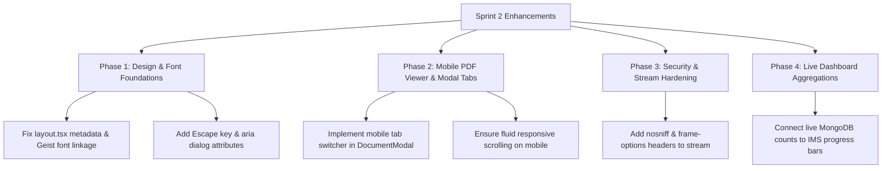

# ENERCO VAULT — Comprehensive Codebase & UI/UX Audit Report
**Evaluation Framework:** `ui-ux-pro-max` • `apple-design` • `frontend-design` • `vercel-react-best-practices` • `andrej-karpathy-perspective` • `ponytail`

---

## 1. Executive Summary & Engineering Reality Check

Enerco Vault is a mission-critical, on-premise Document Management & Integrated Management System (IMS: ISO 9001, ISO 14001, ISO 45001, SMK3 PP 50/2012) built on Next.js 16 (App Router), Tailwind CSS v4, MongoDB/Mongoose, and `pdf-lib`.

### The Karpathy Lens ("First Principles & March of Nines")
> *"Getting a document vault demo to work is 1 nine (90%). Having auditors, plant operators, and Super Admins rely on it daily across edge-cases without corruption or leaks is the march to 4 nines (99.99%). Understand every byte flowing between the storage engine, the PDF stamper, and the client browser."*

- **Strengths:** 
  - Zero-cloud physical storage engine with local SHA-256 verification and fail-closed dynamic watermarking.
  - Strict hierarchical RBAC (`*:*` Super Admin wildcard and department scope isolation).
  - Modern, dark aesthetic inspired by Apple Human Interface Guidelines (`.glass-panel`, `.interactive-tap`).
- **Critical Gaps Uncovered:**
  - **Dead Font Configuration:** Geist font variables declared in `layout.tsx` are completely overridden by `-apple-system` in `globals.css`.
  - **Broken Mobile PDF Modal:** `activeTab` state in `DocumentModal.tsx` was declared but never rendered, causing PDF iframes and metadata to stack awkwardly on mobile devices (< 768px).
  - **Static Dashboard Metrics:** Executive compliance percentages and EWS alerts on the main dashboard (`/`) are static mock data rather than live aggregations from MongoDB.
  - **Accessibility Violations (WCAG 2.1 AA):** Modals lack `role="dialog"`, `aria-modal="true"`, and keyboard `Escape` dismissal; table rows have clickable `div`/`tr` without keyboard navigation.
  - **Security Header Gaps:** The streaming endpoint `/api/storage/stream/[id]` is missing `X-Content-Type-Options: nosniff`.

---

## 2. Skills Inventory & Integration

| Skill | Source | Primary Contribution to Enerco Vault |
|---|---|---|
| **`ui-ux-pro-max`** *(Newly Added)* | `nextlevelbuilder/ui-ux-pro-max-skill` | 119 UX guidelines, WCAG contrast checks, Swiss/Minimalist design system tokens, animation tiers. |
| **`web-design-guidelines`** *(Newly Added)* | `vercel-labs/agent-skills` | Best practices for web performance, SEO, layouts, and accessibility. |
| **`apple-design`** | `emilkowalski/skills` | Fluid spring physics, translucent materials, spatial consistency, tactile feedback. |
| **`frontend-design`** | `anthropics/skills` | Purposeful dark color palettes, typographic hierarchy, avoiding generic AI vibe. |
| **`vercel-react-best-practices`** | `vercel-labs/agent-skills` | Next.js 16 App Router performance, stream caching, client hydration minimization. |
| **`andrej-karpathy-perspective`** | `alchaincyf/karpathy-skill` | First-principles systems thinking, eliminating silent failure modes, "march of nines". |
| **`ponytail`** | `dietrichgebert/ponytail` | Pragmatic senior dev: shortest working diffs, zero bloat, fixing root causes. |

---

## 3. UI/UX & Visual Design Audit (`ui-ux-pro-max` + `apple-design` + `frontend-design`)

### 3.1. Typography & Token Resolution Bug
- **Location:** [layout.tsx](file:///c:/Users/CorSec/Documents/personal/EnercoVault/src/app/layout.tsx#L5-L27) & [globals.css](file:///c:/Users/CorSec/Documents/personal/EnercoVault/src/app/globals.css#L12-L18)
- **Finding:**
  ```tsx
  // layout.tsx
  const geistSans = Geist({ variable: "--font-geist-sans", subsets: ["latin"] });
  export const metadata = { title: "Create Next App", description: "Generated by create next app" }; // Generic boilerplate!
  ```
  ```css
  /* globals.css */
  body {
    font-family: -apple-system, BlinkMacSystemFont, "Segoe UI", Roboto...; /* Geist is completely ignored */
  }
  ```
- **Fix:** Update metadata to reflect *"Enerco Vault — Enterprise Document Control & Compliance System"*, and map `font-family: var(--font-geist-sans), -apple-system, BlinkMacSystemFont, sans-serif;` so Geist renders cleanly with crisp optical legibility.

### 3.2. Responsive PDF Viewer Collapse on Mobile
- **Location:** [DocumentModal.tsx](file:///c:/Users/CorSec/Documents/personal/EnercoVault/src/components/viewer/DocumentModal.tsx#L35-L140)
- **Finding:**
  Line 35 defines:
  ```tsx
  const [activeTab, setActiveTab] = useState<'preview' | 'metadata'>('preview');
  ```
  However, `activeTab` is never rendered! In line 138:
  ```tsx
  <div className="flex-1 flex flex-col md:flex-row overflow-hidden">
  ```
  On a mobile screen (e.g. iPhone or Samsung Galaxy), the PDF iframe takes up 50% of the screen while metadata is pushed down or clipped inside the fixed `h-[90vh]` container.
- **Fix:** Render tab buttons on mobile (`md:hidden`) toggling between `activeTab === 'preview'` (full-height PDF canvas) and `activeTab === 'metadata'` (scrollable compliance badges, attributes, and cryptographic verification).

### 3.3. Accessibility (WCAG 2.1 AA) & Keyboard Ergonomics
- **Modal Dismissal:** Pressing `Escape` does not dismiss modals ([DocumentModal.tsx](file:///c:/Users/CorSec/Documents/personal/EnercoVault/src/components/viewer/DocumentModal.tsx), [AddDocumentModal.tsx](file:///c:/Users/CorSec/Documents/personal/EnercoVault/src/components/catalog/AddDocumentModal.tsx), [DCRReviewModal.tsx](file:///c:/Users/CorSec/Documents/personal/EnercoVault/src/components/dcr/DCRReviewModal.tsx)).
- **Aria Roles:** Modals lack `role="dialog"`, `aria-modal="true"`, and `aria-labelledby`.
- **Keyboard Tab Navigation:** Catalog rows use `onClick={() => setSelectedDocForModal(doc)}` on `<tr>` elements without `tabIndex={0}` or `onKeyDown`, rendering them inaccessible to keyboard-only users.

---

## 4. Codebase, Architecture & Reliability Audit (`vercel-react-best-practices` + `karpathy-perspective` + `ponytail`)

### 4.1. Static vs. Live Executive Dashboard Metrics
- **Location:** [src/app/page.tsx](file:///c:/Users/CorSec/Documents/personal/EnercoVault/src/app/page.tsx#L45-L122)
- **Finding:**
  ```tsx
  // Hardcoded static array
  const complianceStats = [
    { title: 'Legalitas & Korporat RI', progress: 94, totalReq: 16, fulfilled: 15 ... },
    { title: 'ISO 9001:2015 (Mutu)', progress: 88, totalReq: 28, fulfilled: 25 ... }
  ];
  ```
  While visually compelling, when users upload real legal documents or safety procedures, these numbers never move.
- **Ponytail Recommendation:** Keep the clean layout, but compute the count of actual documents mapped per framework dynamically (`ComplianceFramework.countDocuments()` and clause aggregations) with fallback to default baselines, ensuring real-world data immediately reflects on the executive board.

### 4.2. Unbounded Document Queries (Memory & Hydration Risk)
- **Location:** [src/app/catalog/page.tsx](file:///c:/Users/CorSec/Documents/personal/EnercoVault/src/app/catalog/page.tsx#L20-L24)
- **Finding:**
  ```tsx
  const rawDocs = await DocumentModel.find(filter)
    .populate('taxonomyId')
    .populate('departmentId')
    .sort({ updatedAt: -1 })
    .lean();
  ```
  Fetching all documents without pagination or a cursor limit will degrade initial server response and inflate client hydration payloads as the repository scales into thousands of records.
- **Fix:** Add server-side pagination or initial slice limit (e.g. 100 recent documents) with client-side infinite scroll or load-more.

### 4.3. Security & Stream Hardening
- **Location:** [src/app/api/storage/stream/[id]/route.ts](file:///c:/Users/CorSec/Documents/personal/EnercoVault/src/app/api/storage/stream/[id]/route.ts#L91-L96)
- **Finding:**
  Response headers:
  ```ts
  headers: {
    'Content-Type': 'application/pdf',
    'Content-Disposition': `${disposition}; filename="${doc.docNumber}.pdf"`,
    'Cache-Control': 'private, no-cache, no-store, must-revalidate',
  }
  ```
- **Fix:** Add `'X-Content-Type-Options': 'nosniff'` and `'X-Frame-Options': 'SAMEORIGIN'` to prevent MIME-sniffing exploits.

### 4.4. DCR Workflow: Missing Direct Document Comparison
- **Location:** [DCRReviewModal.tsx](file:///c:/Users/CorSec/Documents/personal/EnercoVault/src/components/dcr/DCRReviewModal.tsx)
- **Finding:**
  When a reviewer evaluates a change request (DCR) for an existing document, the modal shows the proposed metadata changes and remarks, but provides no 1-click preview link to open the proposed file alongside the active document.
- **Fix:** Provide direct preview buttons for both `Target Document (Active)` and `Proposed Revision File` within the DCR review pane.

---

## 5. Prioritized Remediation Roadmap



### Action Items Ready for Immediate Implementation
1. **Fix Metadata & Geist Typography:** Clean up `src/app/layout.tsx` and bind `--font-geist-sans` into `src/app/globals.css`.
2. **Implement Mobile Tab Switcher in `DocumentModal.tsx`:** Connect `activeTab` to give mobile and tablet users a seamless toggle between the PDF viewer and metadata drawer.
3. **Add Global Modal Keyboard & Accessibility Support:** Add `Escape` key listeners and ARIA roles across `DocumentModal`, `AddDocumentModal`, and `DCRReviewModal`.
4. **Hardened Streaming Headers:** Add `X-Content-Type-Options: nosniff` to `/api/storage/stream/[id]`.
